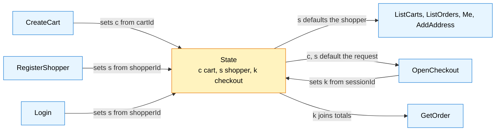

# Aggregate design canvas

ddd-crew [Aggregate Design Canvas v1.1](https://github.com/ddd-crew/aggregate-design-canvas).
**The Storefront BFF has no aggregate.** It has no database, no repository and no
transaction; [ADR 0001](/docs/adr/0001-storefront-bff-bounded-context) states
"No domain model and no database: composition and edge rules only". The carts,
checkout sessions, orders and shoppers it handles are aggregates of the upstream
services (shopping-cart, checkout, customer-ordering); their canvases are on their
own sites.

What the canvas can honestly describe is the one piece of state the edge carries
for a shopper, and it is a **value object held by the browser**, not an aggregate:
`composition.State` in the `sf_state` cookie.

## State (value object)

| Section | Content |
| --- | --- |
| **Name** | `State` (package `composition`), serialised by `Encode` and parsed by `DecodeState`; cookie name `sf_state` |
| **Description** | What the page remembers between requests: the open cart, the shopper and the last checkout session, all opaque upstream ids. It is state, never authentication: nothing in the storefront trusts it for access. |
| **Identity** | None. It has no identity of its own and is replaced as a whole on every change. |
| **Fields** | `CartID` (`c`), `ShopperID` (`s`), `CheckoutID` (`k`); empty fields are omitted from the value. |
| **Where it lives** | The browser. The server stores nothing; any replica can read any cookie. |
| **Commands that change it** | `CreateCart` sets `c` from the upstream's `cartId`; `RegisterShopper` and `Login` set `s` from `shopperId`; `OpenCheckout` sets `k` from `sessionId`. Only a successful (2xx) upstream reply with a valid id changes it. |
| **Events raised** | none |
| **Lifetime** | 30 days, `HttpOnly`, `SameSite=Lax`, `Path=/api/storefront`, `Secure` unless `COOKIE_SECURE=false`. |

Source: `internal/domain/composition/state.go` (`State`, `Encode`, `DecodeState`),
`internal/application/usecases/carts.go` (`CreateCart`),
`shoppers.go` (`adoptShopper`), `checkout.go` (`OpenCheckout`), `orders.go`
(`GetOrder`, `checkoutTotals`) and `internal/adapters/inbound/http/server.go`
(`cookie`).

### Invariants

| # | Invariant | Enforced by | Test |
| --- | --- | --- | --- |
| 1 | Every id is a valid id: 1 to 128 characters of `[A-Za-z0-9._-]`, alphanumeric first, so it cannot alter an upstream path. | `ValidID` | `TestValidID`, `TestValidIDAcceptsEveryCharacterClassEdge` |
| 2 | A bad cookie is an empty state, never an error: malformed input and invalid ids are dropped field by field. | `DecodeState` | `TestDecodeStateDropsGarbage` |
| 3 | The cookie round-trips: `DecodeState(Encode(s)) == s` for valid ids. | `Encode`, `DecodeState` | `TestStateRoundTrip` |
| 4 | An upstream id enters the state only if it passes `ValidID`; an invalid one leaves the state unchanged. | `CreateCart`, `adoptShopper`, `OpenCheckout` | `carts_test.go`, `shoppers_test.go`, `checkout_test.go` |
| 5 | A failed or non-2xx call never sets the cookie. | `Outcome.SetState` stays false (early return in `CreateCart`, `adoptShopper`, `OpenCheckout`) | `TestCreateCartSetsStateCookie` covers the success side |

### Concurrency and consistency

None to speak of: the value is whole, replaced on write, and the last response
wins in the browser. Two tabs can hold different carts; that is the page's
concern. There is no version, no lock and no server-side copy.

## Other value types of the domain package

| Type | What it is | Rule |
| --- | --- | --- |
| `Call`, `Reply` | One outbound request and one raw answer | `Reply.OK` is "status 2xx"; a non-2xx reply is data, not an error |
| `Budgets`, `Class` | The three time limits | all positive (`Validate`); `For` maps a class to its limit |
| allowlist | The closed route list | `Allowed(Call)`; see [Use cases](/docs/ddd/use-cases) |
| idempotency key | A string minted from route, subject, action and window | deterministic, `sf-` + 40 hex (`MintKey`) |

Each is immutable and compared by value; none has identity, a lifecycle or an
invariant that spans more than itself, which is why none is an aggregate.
