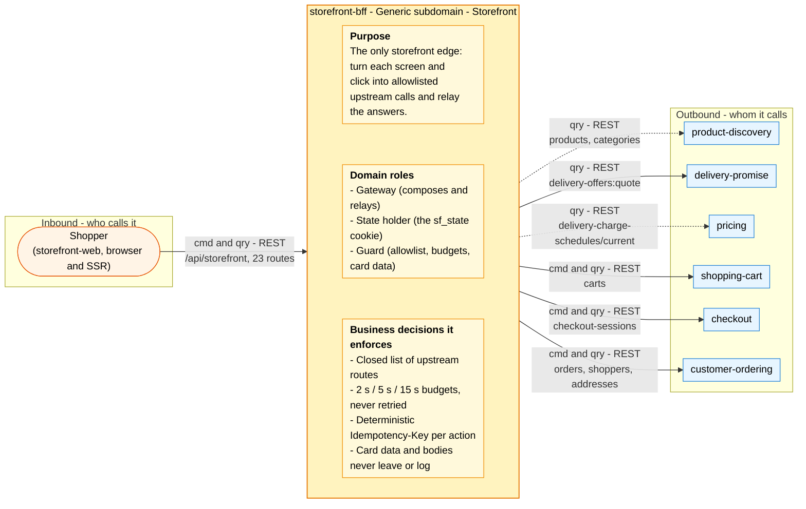

# Bounded context canvas

ddd-crew [Bounded Context Canvas v5](https://github.com/ddd-crew/bounded-context-canvas),
filled from [ADR 0001](/docs/adr/0001-storefront-bff-bounded-context), the
composition code and the OpenAPI contract. Every message below is carried by the
REST adapters on `develop`; see [Integration](/docs/ecosystem/integration) for
the status of the collaborator on the other side.

## Canvas at a glance

Arrows follow the message type: **solid blue** commands (`cmd`), **dotted green**
queries (`qry`). The BFF has no events, so no event arrow exists.

Source: the communication tables of this page, which follow
`internal/domain/composition/allowlist.go`, `internal/adapters/inbound/http/routes_*.go`
and `apis/openapi.yaml`.

## Name

**storefront-bff**

## Purpose

The only storefront edge (`/api/storefront`): compose the storefront contexts and
the network's delivery quote and shopper routes for the web app, mint
Idempotency-Keys per user action, keep cart, shopper and checkout ids in a
cookie, and never store or log what passes through.

## Strategic classification

| Dimension | Value |
| --- | --- |
| Domain | **Generic** ([Subdomain classification](/docs/ddd/subdomain-classification)) |
| Area | Storefront. No CloudEvents namespace is used (reserved: `com.retailnetwork.storefront.storefront-bff.<entity>.<Event>`); Kong path `/api/storefront` |
| Business model | Conversion enabler (every shopper request passes through it) |
| Evolution | Custom-built plumbing |

## Domain roles

- **Gateway**: `Gateway` and its 23 use cases (`internal/application/usecases`).
- **State holder**: `composition.State` carried in the `sf_state` cookie.
- **Guard**: the allowlist, the budgets, `MintKey`, the card guard and the
  NUL and size limits.

## Inbound communication

| Collaborator | Message | Kind | Channel | Status |
| --- | --- | --- | --- | --- |
| storefront-web (shopper) | the 23 routes of `apis/openapi.yaml` | commands and queries | REST under `/api/storefront` | built; see [API overview](/docs/api-reference) |
| platform | liveness and readiness | queries | `GET /healthz`, `GET /readyz` | built (static 200) |

## Outbound communication

| Collaborator | Message | Kind | Channel | Status |
| --- | --- | --- | --- | --- |
| product-discovery | search, product, categories | queries | `GET /products`, `/products/{id}`, `/categories` | built, verified |
| delivery-promise | quote delivery offers | query | `POST /delivery-offers:quote` | built, verified |
| pricing | current delivery charge schedule | query | `GET /delivery-charge-schedules/current` | built, verified |
| shopping-cart | create, read, list, lines, destination, quote, select | commands and queries | nine allowlisted routes | built, verified |
| checkout | open, read, confirm | commands and queries | `/checkout-sessions` routes | built, verified |
| customer-ordering | orders, tracking, cancel, shoppers, addresses | commands and queries | eight allowlisted routes | built, verified |

No event is published or consumed.

## Ubiquitous language

Edge, upstream, allowlist, budget (query, command, confirm), action id,
Idempotency-Key, state cookie, relay, composition, problem, shopper, cart,
checkout session, PSP token. Full glossary:
[Ubiquitous language](/docs/ddd/ubiquitous-language).

## Business decisions

| Decision | Rule in code |
| --- | --- |
| Which upstream routes may be called | only the 25 templates of `allowed` in `allowlist.go`; ship-to, promise create/confirm/cancel, inventory feeds, policy routes are refused |
| How long a request may take | `Budgets`: 2 s query, 5 s command, 15 s confirm; expiry is 504 and not retried |
| How a retry stays safe | `MintKey`: `sf-` + 40 hex of SHA-256 over route, subject, action or body digest plus a 10-minute window |
| What the cookie holds | `State{CartID, ShopperID, CheckoutID}`, ids matching `ValidID`; nothing trusts it for access |
| What is never accepted | card-shaped keys, a Luhn-valid token, unknown JSON fields on composed bodies, NUL characters, bodies over 1 MiB |
| What is never logged | request and response bodies, cookies, e-mails, addresses |
| What degrades | tracking, order totals and the delivery charge; the required leg never does |

## Assumptions

From [ADR 0002](/docs/adr/0002-storefront-bff-assumptions): public REST-style
paths map to the upstream custom verbs (A1); the prefix is optional (A2);
readiness does not ping the upstreams (A8); bodies of carts, shoppers and
addresses pass through and the upstream owns validation (A10); `session-required`
is 422 because there is no authentication (A11).

## Verification metrics

- 25-template allowlist pinned by `allowlist_test.go`, and no restricted route
  by `TestNoInOrgNetworkRoute` and `TestAllowlistHoldsNoRestrictedRoute`.
- Mutation gate: efficacy 98 and mutant coverage 97 on `internal/domain`
  (measured 100.00 % and 98.57 %).
- Coverage gate 90 % over the domain, application, inbound adapters, the REST
  client and config (`make coverage`).
- 7 in-process integration tests over upstream fakes ([Testing](/docs/development/testing)).

## Open questions

- Readiness never probes an upstream (ADR 0002 A8), so a fully broken upstream
  is visible only through the 5xx ratio on Kong. Is a degraded-mode signal
  wanted? No ADR asks for one.
- `GET /categories` is uncached and costs one upstream call per navigation
  render (ADR 0004 asks to revisit if it shows in latency).
- The model doc (`storefront/model/model.yaml`) calls the BFF a context while the
  strategic design treats the experience layer as outside the six bounded
  contexts; the two should be reconciled in warehouse-docs.
