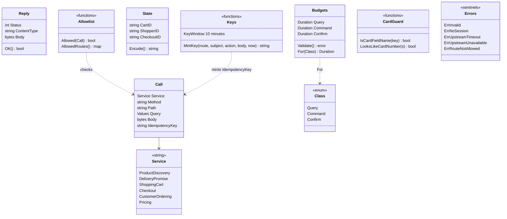
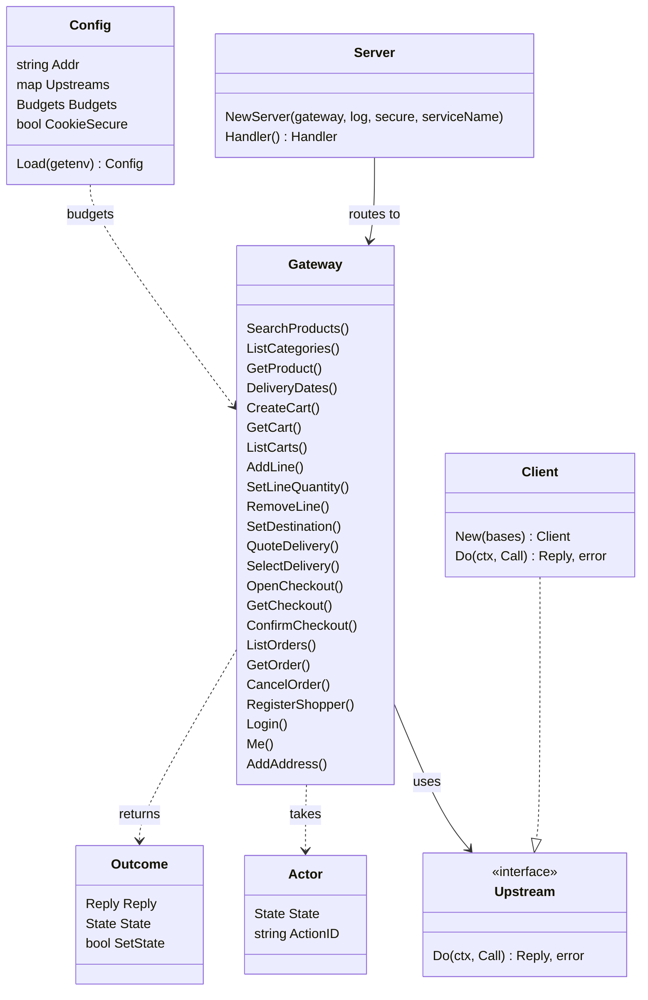

# Class diagrams

Two views. Names are the Go identifiers on `develop`. The domain has value types
and functions, no entity or aggregate
([Aggregate design canvas](/docs/ddd/aggregate-design-canvas)).

## Domain: `internal/domain/composition`

Source: `internal/domain/composition/call.go`, `budget.go`, `state.go`,
`allowlist.go`, `idempotency.go`, `card.go`, `errors.go`. `DecodeState` and
`ValidID` are package functions next to `State`.

## Application and adapters

Source: `internal/application/ports/upstream.go`,
`internal/application/usecases/gateway.go` and the per-area files,
`internal/adapters/outbound/rest/client.go`,
`internal/adapters/inbound/http/server.go`, `internal/config/config.go`,
`cmd/api/main.go` (wiring). The request logger
(`internal/adapters/inbound/requestlog`) and the telemetry adapter
(`internal/adapters/outbound/telemetry`) are middleware and setup, not part of the
use-case model, and are left out. The fleet-template Kafka writer and CloudEvents
packages are not wired by `cmd/api` and are left out too.
