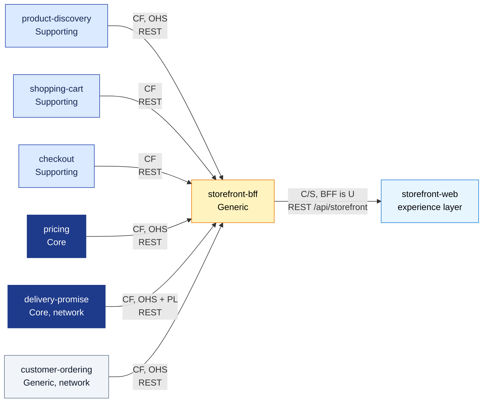

# Context map

The BFF's slice of the fleet map, in the ddd-crew
[Context Mapping](https://github.com/ddd-crew/context-mapping) notation. On every
edge **U** is upstream and **D** downstream; the pattern names how the downstream
relates to the upstream's model: **OHS** Open Host Service, **PL** Published
Language, **CF** Conformist, **ACL** Anti-Corruption Layer, **C/S**
Customer/Supplier. All edges are synchronous REST; there is no Kafka edge. The
fleet-wide map is in the aggregator:
[storefront context map](https://iqvo.github.io/warehouse-docs/storefront/strategic-design/context-map).

Source: `internal/domain/composition/allowlist.go` (which upstream routes exist),
`internal/adapters/outbound/rest/client.go`, `apis/openapi.yaml`, the neighbour
classes in the aggregator's strategic design, and the patterns in the
[Every edge](#every-edge) table below. Arrows point from upstream to downstream.

## Every edge

| Upstream | Downstream | Pattern | Contract the BFF depends on | Events |
| --- | --- | --- | --- | --- |
| `storefront-bff` | `storefront-web` | C/S (the BFF supplies, the web app is the customer; the BFF's OpenAPI is the contract) | `apis/openapi.yaml`, 23 routes | none |
| `product-discovery` | `storefront-bff` | CF + OHS | `GET /products`, `GET /products/{id}`, `GET /categories` | none |
| `delivery-promise` | `storefront-bff` | CF + OHS / PL | `POST /delivery-offers:quote` (the quote contract is open to any client) | none |
| `pricing` | `storefront-bff` | CF | `GET /delivery-charge-schedules/current` | none |
| `shopping-cart` | `storefront-bff` | CF | nine cart routes | none |
| `checkout` | `storefront-bff` | CF | open, read, confirm | none |
| `customer-ordering` | `storefront-bff` | CF + OHS | orders, tracking, cancel, shoppers, addresses | none |

Edges that do not exist, and are kept from existing by tests:

| Edge | Why not |
| --- | --- |
| `storefront-bff` to `customer-payments` or any payment provider | checkout owns authorisation; the BFF only forwards a PSP token to it |
| `storefront-bff` to network restricted routes (`GET /orders/{id}/ship-to`, `POST /promises`, promise `:confirm` and `:cancel`, `POST /inventory-feeds`, policy routes) | the storefront is in-org with the retail network but may call only the Open Host Service routes; `TestNoInOrgNetworkRoute` and `TestAllowlistHoldsNoRestrictedRoute` |
| `storefront-bff` to Kafka | no topic is produced or consumed |
| any network context to `storefront-bff` | the network never depends on the storefront |

## Why these patterns

- **Conformist on every upstream.** The BFF relays upstream bodies and problems
  untouched (ADR 0004 and ADR 0005 say so explicitly): it adopts each upstream's
  model instead of translating it, which is why a new upstream field reaches the
  page without a BFF change, except in the two composed routes.
- **No ACL.** The only translations are the route verbs (A1 in ADR 0002: a public
  `PATCH` becomes the cart's `:set-quantity` command) and the composed views;
  neither renames a domain concept.
- **Open Host on the supplier side.** product-discovery, delivery-promise and
  customer-ordering publish routes meant for shoppers; the BFF stays inside that
  list.
- **Customer/Supplier toward the web app.** The BFF shapes its REST edge for
  storefront-web (ADR 0004 added `GET /categories` for the navigation bar), and
  an upstream contract change surfaces first in the integration tests and in
  `allowlist.go`.
