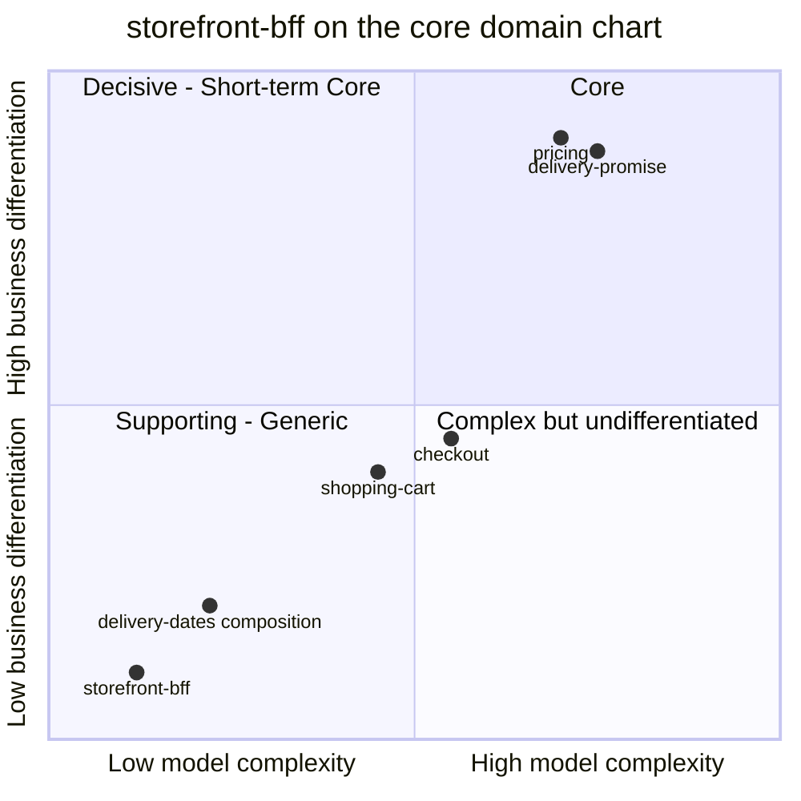

# Core domain chart

Following the ddd-crew [Core Domain Charts](https://github.com/ddd-crew/core-domain-charts):
business differentiation on the vertical axis, model complexity on the horizontal
axis. Mermaid numbers the quadrants 1 = top-right (Core), 2 = top-left,
3 = bottom-left (Supporting or Generic when also low), 4 = bottom-right.

The coordinates are a judgement made from the evidence below, not a measurement;
the class itself is [Subdomain classification](/docs/ddd/subdomain-classification).

Source: `internal/domain/composition/*.go` (what the BFF decides),
`internal/application/usecases/*.go` (what it composes) and the neighbour classes
in the aggregator's strategic design
([subdomain classification](https://iqvo.github.io/warehouse-docs/storefront/strategic-design/subdomain-classification)).
The neighbour points are positioned for context only; their own charts place
them.

## Classification: Generic

**Business differentiation is low (y = 0.10).** Nothing the BFF does is a reason a
shopper buys here. The things that are differentiating (the price of speed per
delivery tier, the network's delivery promise) are computed by `pricing` and
`delivery-promise`; the BFF relays them. Its few rules are edge hygiene: do not
let an id alter a path, do not forward card data, do not log bodies, bound every
request in time, make a retried click idempotent.

**Model complexity is low (x = 0.12).** Evidence from the code:

- No aggregate, no entity, no repository: `internal/domain/composition` is pure
  functions and value types (`Call`, `Reply`, `Budgets`, `State`) with no I/O.
- 23 use cases of one shape: validate ids, build an allowlisted call, run it under
  a budget, relay the answer. Two compose more than one call (`DeliveryDates`
  and `GetOrder`), both with a required leg and optional legs.
- One port (`ports.Upstream`) with one implementation.
- A mutation run over the whole domain package measured efficacy 100.00 % on 69
  mutants (`.gremlins.yaml`).

The **delivery-dates composition** sits a little higher (0.22, 0.20): it is the
only place the BFF reshapes data (one tier per quoted offer, with the charge and
the time zone), and the only one that tolerates a failing upstream leg.

## Evolution

**Custom-built plumbing.** The contracts it adapts are custom (six storefront and
network services), so a gateway product would not remove the code. What would
move it: an edge-owned capability with data of its own (personalisation,
server-side cart caching, recommendation blending) would give it a model; none is
planned in the ADRs.
