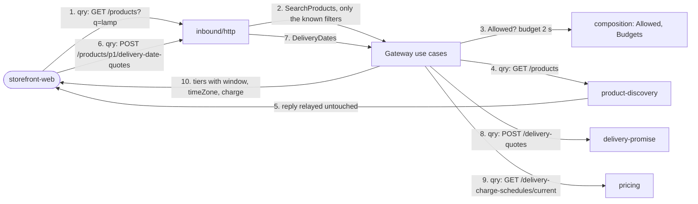
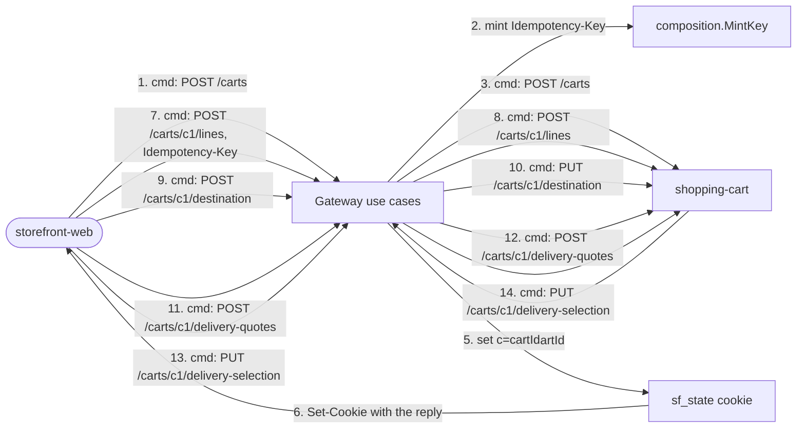
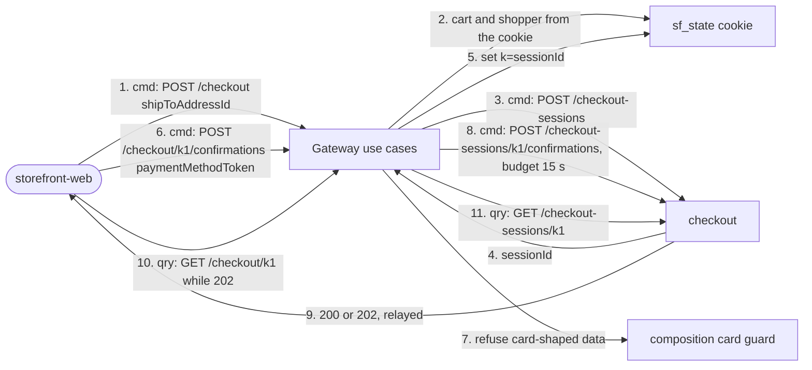
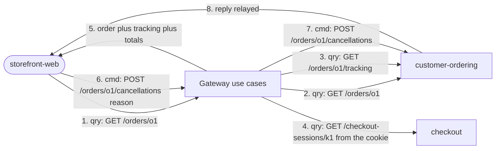

# Domain message flow

[Domain Message Flow Modelling](https://github.com/ddd-crew/domain-message-flow-modelling)
of the key scenarios: commands and queries as numbered messages between
collaborators. Every collaborator is code on `develop`: the HTTP adapter, the
`Gateway` use cases, the domain rules and the REST client; on the other side the
upstream services expose the routes used. **There are no events** in any flow:
the BFF is a synchronous edge ([Domain events](/docs/ddd/domain-events)).
Branches that end in a problem are in
[Sequence diagrams](/docs/ddd/sequence-diagrams) and
[Troubleshooting](/docs/operations/troubleshooting).

## Flow 1: browse and ask for delivery dates

Source: `internal/application/usecases/catalog.go`, `dates.go`,
`internal/domain/composition/allowlist.go`. Step 9 is optional: a failure drops
only the charge.

## Flow 2: build a cart

Source: `internal/application/usecases/carts.go`, `gateway.go`,
`composition/idempotency.go`, `internal/adapters/inbound/http/routes_cart.go`.
Every command carries a minted key; the cart service calls delivery-promise
itself on step 12, hence the 5 s command budget.

## Flow 3: open checkout and confirm

Source: `internal/application/usecases/checkout.go`, `composition/card.go`.
Step 2 fails with `session-required` when the cookie has no shopper.

## Flow 4: read and cancel an order

Source: `internal/application/usecases/orders.go`. Steps 3 and 4 are optional and
share the 2 s query budget with step 2; the cancel reason is 1 to 200
characters.
