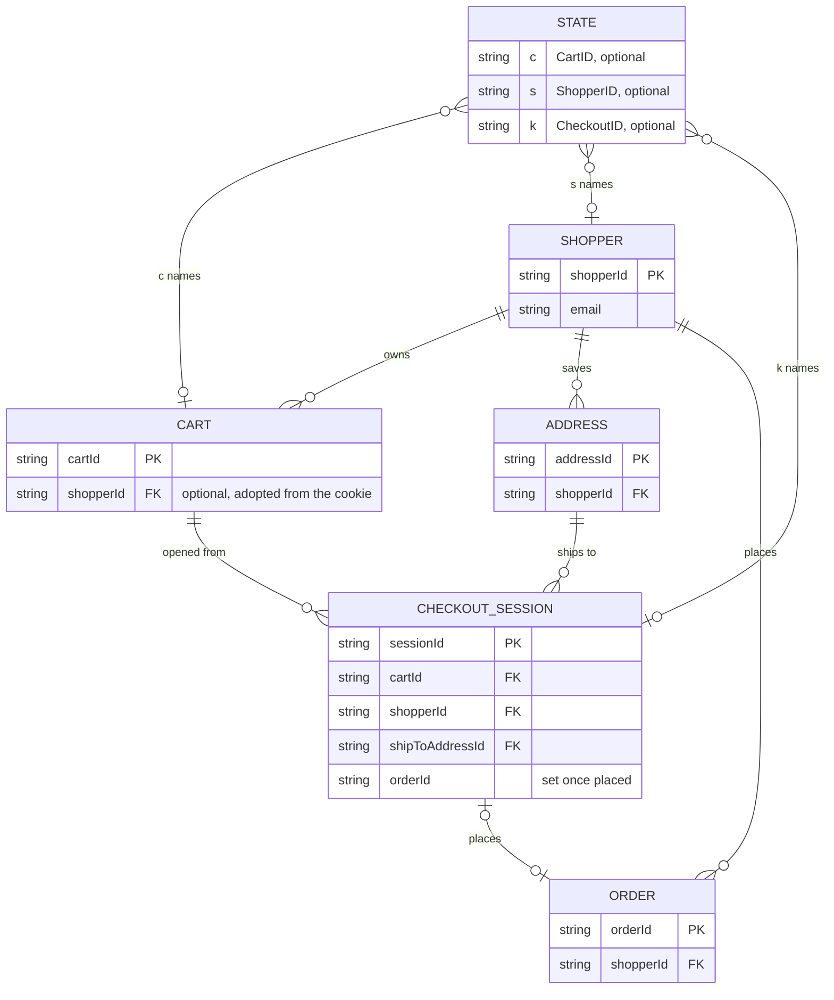

# Entity-relationship diagram

**The Storefront BFF owns no tables.** It has no database driver, no migrations
directory and no `DATABASE_URL`; [Configuration](/docs/operations/configuration)
lists every variable it reads and none is a store. A conventional ER diagram of
its own data would be empty.

What can be drawn truthfully is the **logical model of the identifiers** the edge
carries: the `sf_state` cookie value (`State`) and the upstream resources its three
ids point to. Every box except `STATE` lives in another service's database; the
BFF knows each only as an opaque id validated by `ValidID`.

Source: `internal/domain/composition/state.go` (`State` and its three fields),
`internal/application/usecases/checkout.go` (`openCheckoutRequest`: `cartId`,
`shipToAddressId`, the cookie's `shopperId`; the `sessionId` response),
`orders.go` (`checkoutTotals` joins on `OrderID`), `carts.go` (`shopperId` in a
new cart's body), `shoppers.go` (`shopperId`) and the fixtures of
`cmd/api/integration_journey_test.go`. Only the fields the BFF reads or sends are
drawn; the upstream resources have many more, in their own OpenAPI documents.

## What each relationship is, and who guarantees it

| Relationship | Held by | Guarantee in the BFF |
| --- | --- | --- |
| `STATE` names cart, shopper, checkout | the browser cookie | none beyond `ValidID`; a stale id simply yields an upstream 404 |
| `SHOPPER` owns `CART` | shopping-cart | the BFF passes `shopperId` when it creates a cart for a cookie that has a shopper |
| `CART` opens `CHECKOUT_SESSION` | checkout | `OpenCheckout` requires a valid `cartId` (cookie or body) and a shopper |
| `CHECKOUT_SESSION` places `ORDER` | checkout, customer-ordering | `GetOrder` joins the session's totals only when `orderId` equals the requested order |
| `SHOPPER` saves `ADDRESS` | customer-ordering | `AddAddress` posts to the cookie's shopper; the address body passes through unlogged |

There is no foreign key anywhere in the BFF and no referential check: consistency
is whatever the upstreams enforce, and the edge's only integrity rule is that an
id is shaped so it cannot rewrite an upstream path.

## Why there is no schema

Persisting anything at the edge would duplicate data the upstreams own and make a
restart or a second replica matter. The design keeps the edge stateless on
purpose ([ADR 0002](/docs/adr/0002-storefront-bff-assumptions), A7 and A8:
state in the cookie, no database, no Kafka). The fleet-template migration and
Kafka scaffolding, which a service with a store would use, is not wired.
