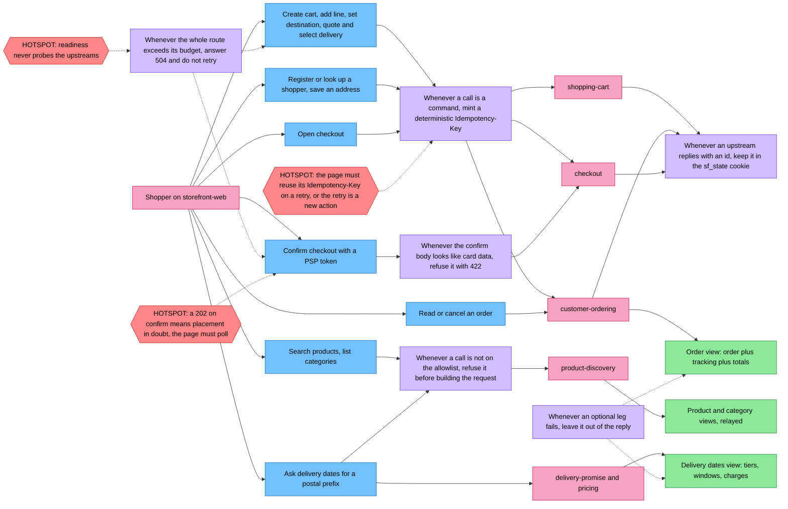

# EventStorming

Design-level EventStorming of a purchase journey, using the
[ddd-crew glossary](https://github.com/ddd-crew/eventstorming-glossary-cheat-sheet)
colours: blue commands, lilac policies, pink external systems, green read models,
red hotspots. There are **no orange domain events**: the BFF raises none
([Domain events](/docs/ddd/domain-events)). The facts of a purchase (cart
changed, order placed, payment captured) are events of the upstream contexts and
appear here as pink external systems answering a command. The model was derived
from the code and ADRs, not from a workshop.

Source: `internal/domain/composition/{allowlist,budget,idempotency,card,state}.go`,
`internal/application/usecases/*.go` (`call`, `relay`, `begin`, `adoptShopper`,
`GetOrder`, `DeliveryDates`), `internal/adapters/inbound/http/server.go` (`respond`),
`docs/adr/0001` to `0005`. Arrows show the order of a journey, not data
ownership.

## Reading it

1. **Browse.** Search, product and category reads are plain relays to
   product-discovery under the 2 s query budget.
2. **Delivery dates.** One composed view: the quote is required, the charge
   schedule is optional (policy 6).
3. **Build the cart and register.** Commands carry a minted key (policy 2); the
   ids that come back go into the cookie (policy 5).
4. **Open checkout and confirm.** Open needs a shopper and a cart from the cookie.
   Confirm refuses card data before anything leaves (policy 4) and has the 15 s
   budget (policy 3).
5. **After the purchase.** Order detail is a composed view with an optional
   tracking leg and totals leg (policy 6).

## Hotspots

| # | Hotspot | State |
| --- | --- | --- |
| 1 | **A `202` on confirm.** The payment outcome is in doubt; the page polls `GET /checkout/{id}` and may re-send the same confirm with the same `Idempotency-Key`. The BFF does not decide. | By design ([ADR 0002](/docs/adr/0002-storefront-bff-assumptions)) |
| 2 | **Readiness is a static 200.** A dead upstream shows up as 503/504 and on Kong's 5xx ratio, never as a pod restart (A8), so one slow upstream cannot take the whole edge out of rotation. | Accepted by ADR 0002 A8 |
| 3 | **Page-owned key.** The page sends one `Idempotency-Key` per user submit and reuses it on retry; a retry with a fresh key is a new action. The same key with a different body is answered 409 `idempotency-key-reused` by the provider. | By design ([ADR 0006](/docs/adr/0006-adopt-the-fleet-rest-api-guideline), supersedes ADR 0002 A3) |
| 4 | **Relays are unshielded.** An upstream field change reaches the page untouched, except in the two composed routes (ADR 0004, ADR 0005). | Accepted |
| 5 | **No event, no push.** The page cannot learn that an order changed without asking again. | By design; revisit only with a real need |
