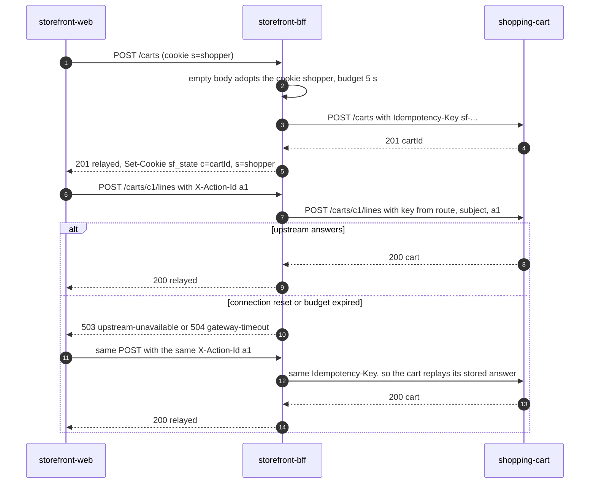
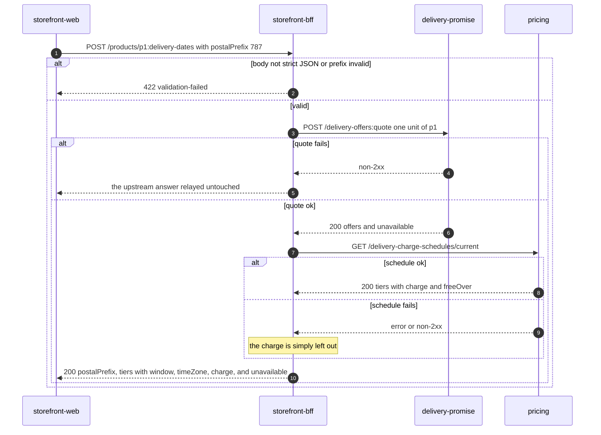
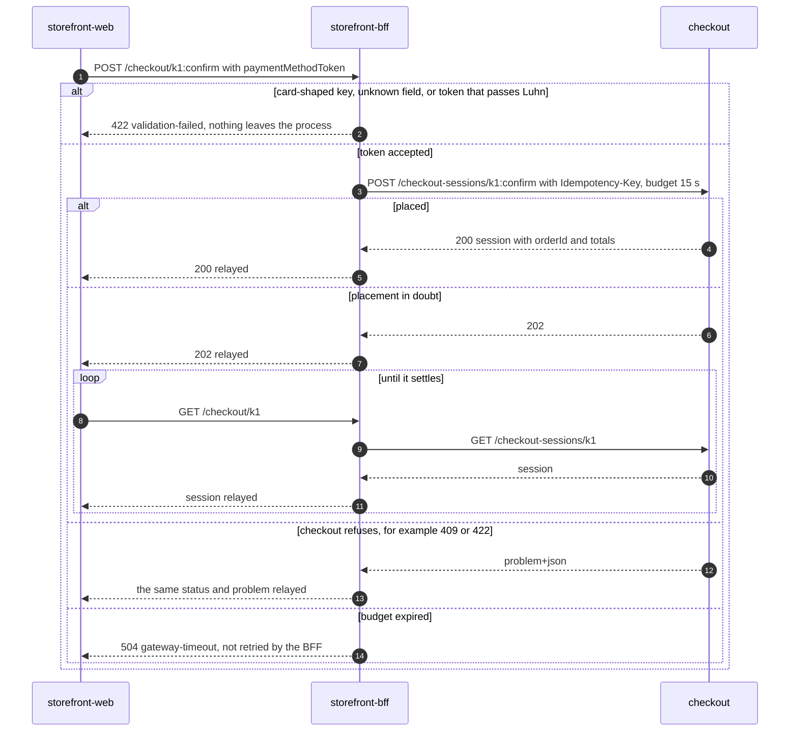
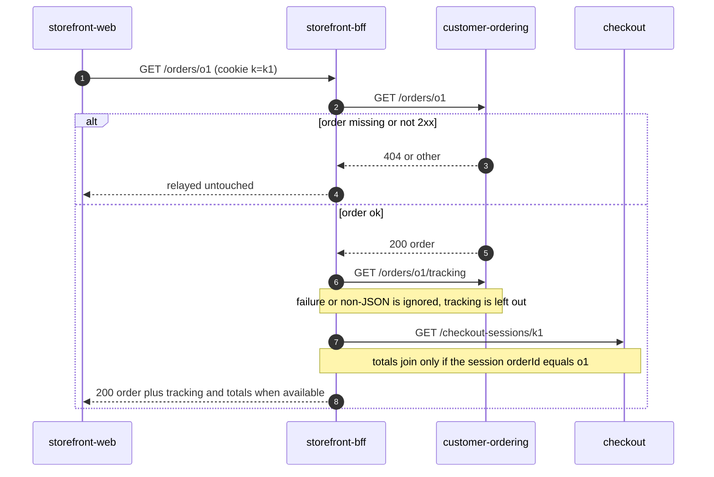

# Sequence diagrams

Four flows, with their error branches, drawn from the use cases and the HTTP
adapter. Participants are the browser app, the BFF (`cmd/api`) and the upstream
services. Problem names are the `/problems/` slugs of the edge.

## Create a cart and add a line (with a retried click)

Source: `internal/application/usecases/carts.go` (`CreateCart`, `AddLine`,
`cartCommand`), `gateway.go` (`call` mints the key, `classify`),
`internal/domain/composition/idempotency.go` (`MintKey`),
`internal/adapters/inbound/http/server.go` (`respond`, `cookie`).

## Delivery dates on a product page (one leg optional)

Source: `internal/application/usecases/catalog.go` (`DeliveryDates`),
`dates.go` (`chargesByTier`, `composeDates`: only `QUOTED` offers become tiers),
[ADR 0005](/docs/adr/0005-delivery-dates-carry-the-window-time-zone) (time zone
relayed as quoted). The two calls share one 2 s query budget.

## Confirm checkout (the purchase step)

Source: `internal/application/usecases/checkout.go` (`ConfirmCheckout`: card-key
probe, strict decode, token length and Luhn check), `gateway.go` (`relay`, the
Confirm budget), `internal/domain/composition/card.go`. The 202 behaviour is the
`GetCheckout` comment in `checkout.go`; its body is the upstream's.

## Order detail with tracking and totals

Source: `internal/application/usecases/orders.go` (`GetOrder`, `checkoutTotals`).
All three calls share one 2 s query budget. If the order body is not a JSON
object the answer is `503 upstream-unavailable`.
