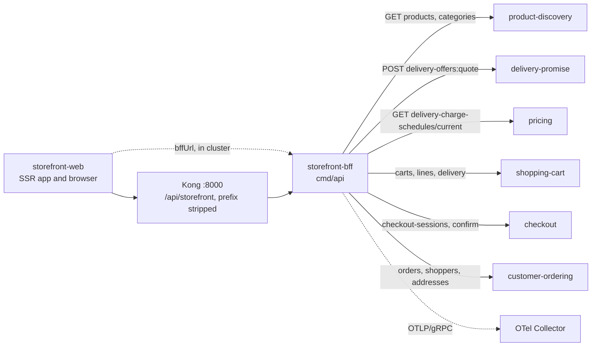

# Integration

How `storefront-bff` fits with the rest of the fleet, with the **status of every
edge**. Three words are used strictly:

- **Built**: code on this repo's `develop` that does the job.
- **Verified**: the other side was read on its own `origin/develop` and exposes
  the route (checked 2026-11-01 against the `apis/openapi.yaml` of
  product-discovery, delivery-promise, pricing, shopping-cart, checkout and
  customer-ordering, and `warehouse-infra` `helm-values/storefront-bff.yaml`).
- **Absent**: no code on either side.

The BFF speaks **synchronous REST only**. It has no Kafka producer or consumer,
no database and no MCP or A2A endpoint, so there is no event contract to
document and no AsyncAPI file.

## Edge map

Source: `internal/domain/composition/allowlist.go` (the routes),
`cmd/api/main.go` (wiring), `internal/adapters/outbound/rest/client.go`, and
`warehouse-infra` `helm-values/storefront-bff.yaml` and
`helm-values/storefront-web.yaml` (Kong route `/api/storefront` with the prefix
stripped, the six upstream URLs, the web app's `bffUrl`). Solid edges have code
on both sides.

## Inbound

| Caller | Protocol | Contract | Status |
| --- | --- | --- | --- |
| storefront-web (browser and SSR) | REST, JSON, unauthenticated | `apis/openapi.yaml`, [API overview](/docs/api-reference) | **Built + verified.** Reaches the BFF through Kong at `/api/storefront` or, server side, at `http://storefront-bff.warehouse-systems.svc.cluster.local:80`. The route answers with or without the prefix. |
| Kong (gateway) | HTTP | Gateway API `HTTPRoute`, path prefix `/api/storefront`, `stripPath: true` | **Built + verified** in `warehouse-infra` (`gatewayApi.enabled: true`). |

## Downstream: the six upstreams

Each upstream is configured by one mandatory base URL
([Configuration](/docs/operations/configuration)). The BFF may call **only** the
routes below; the list is closed in code (`composition.Allowed`) and any other
call is refused before a request is built.

| Upstream | Env var | Routes the BFF calls | Used by | Status |
| --- | --- | --- | --- | --- |
| product-discovery | `PRODUCT_DISCOVERY_URL` | `GET /products`, `GET /products/{id}`, `GET /categories` | search, product page, category tree | **Built + verified** |
| delivery-promise | `DELIVERY_PROMISE_URL` | `POST /delivery-offers:quote` | `POST /products/{id}:delivery-dates` | **Built + verified** |
| pricing | `PRICING_URL` | `GET /delivery-charge-schedules/current` | the charge per tier on delivery dates | **Built + verified** |
| shopping-cart | `SHOPPING_CART_URL` | `POST /carts`, `GET /carts`, `GET /carts/{id}`, `POST /carts/{id}/lines`, `POST /carts/{id}/lines/{item}:set-quantity`, `POST /carts/{id}/lines/{item}:remove`, `POST /carts/{id}:set-destination`, `POST /carts/{id}:quote-delivery`, `POST /carts/{id}:select-delivery` | the cart routes | **Built + verified** |
| checkout | `CHECKOUT_URL` | `POST /checkout-sessions`, `GET /checkout-sessions/{id}`, `POST /checkout-sessions/{id}:confirm` | open, poll, confirm | **Built + verified** |
| customer-ordering | `CUSTOMER_ORDERING_URL` | `GET /orders`, `GET /orders/{id}`, `GET /orders/{id}/tracking`, `POST /orders/{id}:cancel`, `GET /shoppers`, `POST /shoppers`, `GET /shoppers/{id}`, `POST /shoppers/{id}/addresses` | orders, register, e-mail "login", `/me`, addresses | **Built + verified** |

Public paths map to upstream verbs in
[ADR 0002](/docs/adr/0002-storefront-bff-assumptions) (A1): for example
`PATCH /carts/{id}/lines/{item}` is `POST .../lines/{item}:set-quantity`, and
`POST /checkout` is `POST /checkout-sessions`.

### What every call carries

- `Accept: application/json, application/problem+json`; `Content-Type:
  application/json` when there is a body.
- `Idempotency-Key` on every non-GET: `sf-` plus 40 hex characters, deterministic
  for route, subject (cookie shopper, else cart, else `anonymous`), the page's
  `X-Action-Id` or the body digest plus a 10-minute window. Queries carry none.
- The `traceparent` of the edge request (client span from `otelhttp`), so one
  trace crosses the BFF hop.
- No `Authorization`, cookie or other caller header: nothing is forwarded except
  the body, the allowlisted query parameters and the headers above.

### Composed routes

| BFF route | Calls | Required / optional |
| --- | --- | --- |
| `POST /products/{id}:delivery-dates` | delivery-promise quote, then pricing charge schedule | the quote is required, the charge schedule is optional (tiers lose `charge` and `freeOver`) |
| `GET /orders/{id}` | order, then order tracking, then the cookie's checkout session | the order is required; tracking and totals are optional, totals only when the session placed this order |
| every other route | exactly one upstream call | the upstream answer is relayed untouched |

### Failure behaviour

| Situation | What the BFF does |
| --- | --- |
| Upstream answers with any HTTP status | Relayed as is: status, `Content-Type` and body, including its own problem+json. The BFF does not retry, rewrite or translate it. |
| Upstream unreachable, connection reset, reply over 4 MiB, 2xx body not parseable where the composition needs it | `503 /problems/upstream-unavailable`; nothing is retried. |
| Route budget expires (2 s query, 5 s command, 15 s confirm) | `504 /problems/gateway-timeout`; the in-flight upstream call is cancelled and not retried. |
| Client disconnects | `499 /problems/client-closed-request`. |
| An upstream is down but the rest are up | Only routes that need it fail. Readiness stays green on purpose, so one slow upstream cannot take the whole edge out of rotation (ADR 0002, A8). |
| One URL is missing or not an absolute `http(s)` URL | The process refuses to boot and names it. |

A retry of a command is safe: the same `X-Action-Id` (or the same body inside the
same 10-minute window) reaches the upstream with the same `Idempotency-Key`, so
the upstream answers from its stored result.

## Absent edges (on purpose)

- **No Kafka, no events.** The BFF publishes and consumes nothing. ADR 0001
  reserves the namespace `com.retailnetwork.storefront.storefront-bff.<entity>.<Event>`
  and the topic `retailnetwork.storefront-bff.events`; no event uses them.
- **No restricted network routes.** `GET /orders/{id}/ship-to`, `POST /promises`,
  promise `:confirm` and `:cancel`, `POST /inventory-feeds`, policy routes and
  `POST /checkout` of customer-ordering (called by the checkout service, not the
  browser edge) are not on the allowlist. `TestNoInOrgNetworkRoute` and
  `TestAllowlistHoldsNoRestrictedRoute` fail the build if they appear.
- **No call to customer-payments.** The BFF never talks to the payment
  service or a payment provider: confirm sends only the PSP token to checkout,
  which owns authorisation.
- **No call between BFF replicas, no shared cache, no session store.**
- **No MCP and no A2A**: the REST edge is the only surface, and REST is
  unauthenticated fleet-wide.

## Infrastructure wiring

`warehouse-infra` (`origin/develop`) carries a values file for the service
(`helm-values/storefront-bff.yaml`: six `*Url` values in the `warehouse-systems`
namespace, `cookieSecure: "false"` for the plain-HTTP kind cluster, Gateway API
route `/api/storefront`), a Terraform app entry, a dashboard and the alert rules
described in [Observability](/docs/operations/observability).
