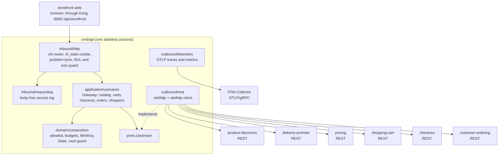

# Architecture

`storefront-bff` follows the fleet's hexagonal (ports and adapters) layout in its
smallest form: dependencies point inward, the domain imports nothing from the
rest of the module, and only `cmd/api` wires the layers together. It is
**stateless**: no database, no Kafka, no cache and no session store. Everything
on this page is on `develop`.

## Layout

| Layer | Path | Role |
| --- | --- | --- |
| Domain | `internal/domain/composition` | Pure rules, no I/O: `Service` (the six upstreams), `Call` and `Reply`, the closed route allowlist (`Allowed`, `AllowedRoutes`), `Budgets` and `Class` (`Query`, `Command`, `Confirm`), `MintKey`, `State` with `Encode`/`DecodeState` and `ValidID`, the card guard (`IsCardFieldName`, `LooksLikeCardNumber`), and the edge errors (`ErrInvalid`, `ErrNoSession`, `ErrUpstreamTimeout`, `ErrUpstreamUnavailable`, `ErrRouteNotAllowed`). |
| Application | `internal/application/ports` | One OUT port, `Upstream.Do(ctx, Call) (Reply, error)`: a reply for any HTTP status, an error only when no answer arrived. `ports` holds only interfaces. |
| Application | `internal/application/usecases` | `Gateway` and its composition use cases, one method per route (see [Use cases](/docs/ddd/use-cases)): catalog, carts, checkout, orders, shoppers, plus `dates.go` (the delivery-dates composition). |
| Inbound adapter | `internal/adapters/inbound/http` | chi router: route table (`routes_catalog.go`, `routes_cart.go`, `routes_checkout.go`, `routes_account.go`), the `sf_state` cookie, RFC 9457 problem mapping (`problems.go`), `rejectNUL` body and query guard with the 1 MiB cap, `recoverPanic`, `/healthz` and `/readyz`, and the optional `/api/storefront` prefix strip. No auth middleware. |
| Inbound adapter | `internal/adapters/inbound/requestlog` | The body-free structured access log (`http request`). |
| Outbound adapter | `internal/adapters/outbound/rest` | `Client` implements `Upstream` over `net/http` with `otelhttp`: one base URL per service, no redirects, no client timeout, 4 MiB reply cap. |
| Outbound adapter | `internal/adapters/outbound/telemetry` | OTel setup (OTLP/gRPC traces and metrics, runtime metrics) and the trace-aware slog handler. |
| Config | `internal/config` | `Load(getenv)` parses and validates the environment; every problem is reported together and refuses the boot. |
| Composition root | `cmd/api` | `main.go` (`run`: config, telemetry, client, gateway, server, graceful shutdown) and `telemetry.go`. |
| Scaffold leftovers | `internal/adapters/outbound/kafka`, `internal/adapters/kafka/cloudevents` | Fleet-template Kafka writer and CloudEvents envelope. **Not imported by `cmd/api`**: the BFF produces and consumes nothing. Kept only so the template's fitness sensors have something to check. |
| Fitness tests | `internal/architecture` | arch-go and source-scanning tests; see below. |

The one port is the whole outbound contract of the application layer:

```go
// internal/application/ports/upstream.go
type Upstream interface {
    Do(ctx context.Context, call composition.Call) (composition.Reply, error)
}
```

Because a non-2xx answer is a `Reply` and not an error, a problem+json from an
upstream travels to the browser unchanged; only "no answer" (connection failure,
oversize reply, expired budget) becomes an edge problem.

## Binaries and ports

| Binary | Role | Port | Probes |
| --- | --- | --- | --- |
| `cmd/api` | The storefront edge: REST under `/api/storefront` (prefix optional), composition over six upstream REST services, no workers or consumers. | `PORT`, default `8080` (all interfaces) | `GET /healthz`, `GET /readyz`: both static `200 {"status":"ok"}`; readiness does **not** probe the upstreams |

`cmd/api` is the only directory under `cmd/`: there is no MCP server and no A2A
server (the REST edge is the whole surface). Every variable is in
[Configuration](/docs/operations/configuration); how it deploys and stops is in
the [Runbook](/docs/operations/runbook).

## Container diagram



Source: `cmd/api/main.go` (wiring order: `config.Load`, `startTelemetry`,
`rest.New`, `usecases.NewGateway`, `inbound.NewServer`),
`internal/adapters/inbound/http/server.go` (`router`, middleware order),
`internal/application/ports/upstream.go`,
`internal/domain/composition/call.go` (the six `Service` constants) and
`internal/architecture/architecture_test.go`.

The middleware order is the fleet observability standard
([ADR 0003](/docs/adr/0003-fleet-observability-standard)): request id, the
`otelchi` server span, the request-duration histogram, the request logger,
`recoverPanic`, then `rejectNUL`.

## Data stores

None. The BFF reads no database and writes no file. The only state it keeps is
the `sf_state` cookie in the browser (`c` cart, `s` shopper, `k` last checkout
session, all opaque ids, 30 days, `HttpOnly`, `SameSite=Lax`, `Path=/api/storefront`)
and a few in-flight request values. Everything durable lives in the upstream
services, so a restart loses nothing and any number of replicas behave alike
([ADR 0002](/docs/adr/0002-storefront-bff-assumptions), A8). The chart still
carries an optional HPA, Ingress and Gateway API route; see the
[Runbook](/docs/operations/runbook).

## Rules enforced by `internal/architecture`

The tests run on every PR (`arch-test` job, `make arch-test`); 35 top-level
tests in all. The ones that define this service:

| Test | Rule |
| --- | --- |
| `TestHexagonalArchitecture` (6 subtests) | `**.internal.domain.**` depends only on domain; `**.internal.application.**` only on domain and application; inbound and outbound adapters do not depend on each other; nothing under `internal/` imports `cmd`; `internal/application/ports` holds only interfaces. |
| `TestNoInOrgNetworkRoute`, `TestAllowlistHoldsNoRestrictedRoute` | The BFF names no restricted retail-network route (ship-to, promise create/confirm/cancel, inventory feeds, policy) and the allowlist holds none. |
| `TestBFFNeverLogsBodies` | No log call receives a request or response body. |
| `TestNoCardDataAnywhere` | No raw card handling outside the guard; card data is rejected, never stored or logged. |
| `TestRuntimeBinaryHasNoInMemoryAdapters` | No non-test file under `cmd/**` imports an in-memory adapter. |
| `TestNoGoFilesAtRepoRoot` | The module root holds no Go file. |
| `TestNoAuthMiddlewareReintroduced` | No bearer or JWT code in the inbound adapters: REST is unauthenticated fleet-wide. |
| `TestMCPAdapterDependencyRule`, `TestMCPOptionalToolInputsCarryOmitempty`, Kafka writer, outbox, CloudEvents and DLQ sensors | Fleet-template guards for features this service does not have (MCP, Kafka, outbox, CloudEvents) |

Each source-scanning sensor has a `...SensorBites` companion proving it can fail.
Commands and counts are on [Testing](/docs/development/testing).
